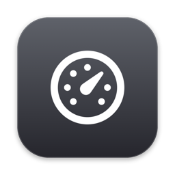
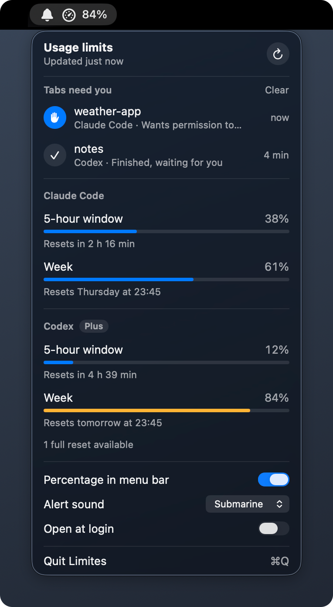
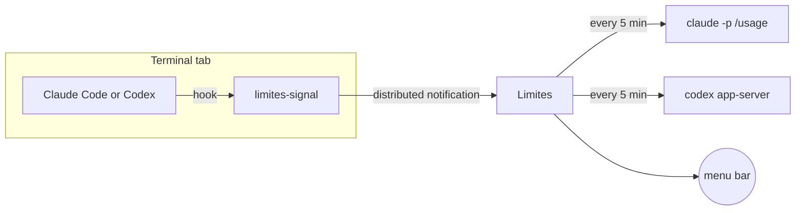

<p align="center">
  
</p>

<h1 align="center">Limites</h1>

<p align="center">
  Claude Code and Codex usage limits in your Mac menu bar,<br>
  and a bell that swings when a terminal tab is waiting for you.
</p>

<p align="center">
  <a href="https://github.com/joshazze/limites/actions/workflows/ci.yml"></a>
  
  
  <a href="LICENSE"></a>
</p>

<p align="center">
  
</p>

*Limites* is Portuguese for "limits". The screenshot uses the built-in demo data.

## Features

- **Both agents in one glance.** The 5-hour and weekly windows for Claude Code (plus the per-model weekly window when your plan has one) and for Codex, each with its reset time. Codex also shows your plan and how many full resets you have banked.
- **A gauge that tells the truth.** The menu bar needle follows the highest usage across every window, because that is the limit that will stop you first. The percentage next to it is optional.
- **Tab alerts.** When an agent asks for permission, finishes its turn or has a question, Limites plays a sound once and swings a bell in the menu bar. The bell keeps swinging every 6 seconds for two minutes, then every 30 seconds, until you get back to that tab.
- **Alerts clear themselves.** Press a key in the tab, switch to it, send a prompt or close it, and the alert is gone. Click a row to jump straight to its tab.
- **Native and small.** SwiftUI, template icons that follow the menu bar, no Dock icon, about 1,500 lines of Swift, no dependencies.
- **English and Brazilian Portuguese**, picked from your system language.

## Does it use tokens?

No. Nothing Limites does starts a model turn.

| What | How | Cost |
| --- | --- | --- |
| Claude Code limits | `claude -p /usage --output-format json`, the same `/usage` command you can type in a session. It runs with `--setting-sources ""` and `--strict-mcp-config`, so your hooks and MCP servers stay out of it. | The JSON reports `num_turns: 0`, `total_cost_usd: 0` and zero input and output tokens. |
| Codex limits | `codex app-server` over stdio, JSON-RPC `account/rateLimits/read`, the same protocol the Codex app is built on. | No thread, no turn. |
| Tab alerts | A hook runs the bundled `limites-signal` helper. It finishes in about 10 ms and never writes to stdout, so nothing is added to the conversation. | None. |

Limits refresh every 5 minutes and whenever you open the panel with data older than a minute. A refresh starts each CLI once; `claude -p /usage` takes about 1.5 seconds.

## When does it stay quiet?

| Situation | Sound and bell |
| --- | --- |
| The tab is selected, its Terminal or iTerm2 window is in front, and Automation is allowed | Silent |
| Same, but Automation is not allowed | Rings, then clears as soon as you press a key in the tab |
| The tab is in the background, or another app is in front | Rings |
| A second alert of the same kind for the same session | No new sound |
| Scripted runs (`claude -p`, `codex exec`) | Never alert |

Limites can only tell which tab is in front by asking Terminal or iTerm2 over AppleScript, which macOS gates behind the Automation permission. Without it the app cannot see that you are already looking, so it relies on the tab's activity instead.

## Requirements

- macOS 14 Sonoma or later on Apple silicon
- Swift 5.10 or later, from Xcode or the Command Line Tools
- [Claude Code](https://docs.anthropic.com/en/docs/claude-code) or the [Codex CLI](https://github.com/openai/codex), signed in. Either one is enough; the other section shows that it is not installed.

## Install

```sh
git clone https://github.com/joshazze/limites.git
cd limites
./build.sh --install
```

The script builds a release binary, assembles `Limites.app`, signs it and copies it to `/Applications`. If you have an Apple Development certificate it signs with that, which keeps the Automation permission across rebuilds; otherwise it signs ad hoc and macOS asks again after each build.

On first launch Limites adds itself to your login items (turn it off in the panel) and asks for permission to control Terminal (or iTerm2).

## Set up tab alerts

The usage meters work on their own. Tab alerts need a hook in each agent.

### Claude Code

Add this to `~/.claude/settings.json`, merging with any hooks you already have:

```json
{
  "hooks": {
    "Notification": [
      { "hooks": [{ "type": "command", "command": "/Applications/Limites.app/Contents/MacOS/limites-signal claude 2>/dev/null || true", "timeout": 5 }] }
    ],
    "Stop": [
      { "hooks": [{ "type": "command", "command": "/Applications/Limites.app/Contents/MacOS/limites-signal claude 2>/dev/null || true", "timeout": 5 }] }
    ],
    "UserPromptSubmit": [
      { "hooks": [{ "type": "command", "command": "/Applications/Limites.app/Contents/MacOS/limites-signal claude 2>/dev/null || true", "timeout": 5 }] }
    ]
  }
}
```

### Codex

Copy the hook script somewhere stable and point `~/.codex/config.toml` at it:

```sh
cp scripts/codex-hook.sh ~/.codex/limites-signal.sh
```

```toml
[features]
hooks = true

[[hooks.PermissionRequest]]
[[hooks.PermissionRequest.hooks]]
type = "command"
command = "/Users/you/.codex/limites-signal.sh"
timeout = 5

[[hooks.Stop]]
[[hooks.Stop.hooks]]
type = "command"
command = "/Users/you/.codex/limites-signal.sh"
timeout = 5

[[hooks.UserPromptSubmit]]
[[hooks.UserPromptSubmit.hooks]]
type = "command"
command = "/Users/you/.codex/limites-signal.sh"
timeout = 5
```

Replace `/Users/you` with your home folder. Codex asks you to trust new hooks the next time it starts.

## Permissions and privacy

- **Automation (Terminal, iTerm2).** Used for two things: checking which tab is in front, so an alert stays silent when you are already there, and bringing a tab forward when you click its row. Everything else works without it. Change it in System Settings, Privacy & Security, Automation.
- No Accessibility, Screen Recording or Full Disk Access.
- No network code of its own and no analytics. The two CLIs talk to their own services the way they always do.
- Alerts live in memory only. Quitting the app forgets them.

## How it works



1. **Finding the tab.** `limites-signal` walks up the process tree with `sysctl` until it reaches the `claude` or `codex` process, reads its controlling terminal (for example `/dev/ttys003`) and checks its arguments. Scripted sessions stop here.
2. **Telling the app.** It posts a distributed notification with the session id, event, working directory and tty. A menu bar app is always inactive, so Limites observes it with immediate delivery.
3. **Noticing you came back.** Every second, while alerts are pending, Limites reads the access time of each tab's tty. A key press or a focus event from the terminal is a read on that device, so the timestamp moves; an untouched tab keeps its old one. It is the same value `w` shows as IDLE, and it needs no permission. Activity in the first 1.5 seconds after an alert is ignored, since terminals answer a few escape sequences on their own.

## Development

```sh
swift build                         # debug build
scripts/test.sh                     # parser and formatting tests (swift-testing)
scripts/check-strings.sh            # every UI string has a Portuguese translation
./build.sh                          # assemble build/Limites.app without installing
open build/Limites.app --args --demo
```

`--demo` fills the panel with sample data and ignores real hooks, which is how the screenshot above was taken. `check-strings.sh` gets the keys from the compiler (`-emit-localized-strings`), so interpolated strings are compared exactly as `String(localized:)` looks them up.

| Path | What lives there |
| --- | --- |
| `Sources/Limites/Providers.swift` | Reading and parsing both CLIs |
| `Sources/Limites/AttentionCenter.swift` | Alerts: sound, bell motion, dismissal |
| `Sources/Limites/TerminalBridge.swift` | AppleScript for Terminal and iTerm2 |
| `Sources/Limites/MenuContent.swift` | The panel |
| `Sources/Limites/StatusIcon.swift` | The menu bar image |
| `Sources/limites-signal/main.swift` | The hook helper |
| `Resources/*.lproj` | Translations |
| `scripts/make-icon.swift` | Draws `AppIcon.icns` |

## Limitations

- Claude Code limits come from the human-readable `/usage` text. If its wording changes, parsing stops until the pattern is updated; the tests pin the current format.
- `codex app-server` is the protocol behind the Codex app rather than a documented public API.
- Staying silent for the front tab and jumping to a tab work with Terminal and iTerm2. In other terminals alerts still ring and clear when you type in the tab.
- The build script targets Apple silicon only.

## License

[MIT](LICENSE)
